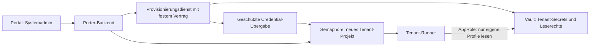

# Automatische Vault-Provisionierung – Recherche und Bewertung

Stand: 16.10.2026. **Dies ist eine Bewertung für einen späteren Ausbau. Es wurde keine Vault-Integration implementiert, kein Vault-Endpunkt aufgerufen und kein Secret angelegt oder verändert.**

## Ergebnis

**Ja, eine automatische Secret-Anlage lässt sich integrieren.** Der vorhandene Stack nutzt bereits Vault KV v2 und besitzt einen klaren Vertrag für Tenant-Pfade und benötigte Schlüssel. Vault stellt die passenden Schreib- und AppRole-APIs bereit. Daraus folgt die technische Machbarkeit; die tatsächliche Vault-Version, Rechtevergabe und Erreichbarkeit der Firmeninstanz wurden nicht live geprüft. [HashiCorp KV-v2-API](https://developer.hashicorp.com/vault/api-docs/secret/kv/kv-v2), [AppRole-API](https://developer.hashicorp.com/vault/api-docs/auth/approle).

Für vollständig über den Porter angelegte Tenants reicht das Speichern von KV-Werten allein nicht: Es werden zusätzlich passende Laufzeit-Leserechte, AppRole-Zugangsdaten, deren sichere Übergabe an Semaphore und eine Wiederaufnahme nach Teilfehlern benötigt. Gültige Registry-Zugangsdaten müssen weiterhin bereitgestellt oder über eine gesonderte Registry-Integration beschafft werden.

Meine Empfehlung ist eine schrittweise Einführung: zunächst geschützte Anlage neuer KV-Objekte für vorbereitete Test-AppRoles; anschließend die vollständige Tenant-Provisionierung über einen eng definierten Provisionierungsdienst. Tenant-Deployment-AppRoles behalten ausschließlich ihre bisherigen Leserechte.

## Geprüfter lokaler Stand

Untersucht wurden der Porter-Zwischenstand `2328f78` und das benachbarte Repository `azubiorga-semaphore-git` auf Commit `182007c`, dessen Arbeitsbaum bei der Prüfung sauber war. Die Dokumentation beschreibt diesen lokalen Stand; eine andere in Semaphore verwendete Revision kann abweichen.

| Quelle | Feststellung |
|---|---|
| Porter: `backend/app/bootstrap.py`, `routers/projects.py` | Vault-Presets enthalten öffentliche Konfiguration. Der Ressourceneditor schreibt geschützte Werte nach Semaphore, nicht nach Vault. |
| Porter: `project_backup.py`, `routers/admin.py` | Kopien entfernen Bootstrap-Credentials; persistierte Wizard-Entwürfe und Presets dürfen keine Secrets enthalten. |
| Stack: `playbooks/tasks/resolve-program-runtime.yml` | Programm- und Provider-Objekte werden getrennt mit `community.hashi_vault.vault_kv2_get`, AppRole, HTTPS-Zertifikatsprüfung und `no_log: true` gelesen. |
| Stack: `programs/*/program.yml`, `database-types/*/driver.yml` | Anwendungen und Provider definieren ihre Vault-Profile und Pflichtschlüssel. |
| Stack: `guides/MANDANTENFAEHIGKEIT.md`, `SETUPGUIDE.md` | Eigene AppRole je Projekt; Leserechte nur auf eigene Mandantenpfade. Explizite Pfad-Overrides haben Vorrang vor automatisch abgeleiteten Pfaden. |

### Konkrete Secret-Verträge

Bei `vault_kv_mount=kv`, `vault_tenant_secret_root=semaphore/tenants` und `tenant_slug=qa-a` ergeben sich ohne explizite Overrides folgende **logische KV-Pfade**. Der Mount `kv` und das HTTP-API-Segment `data/` gehören nicht in die Ansible-Variable für den logischen Secret-Pfad.

| Verwendung | Logischer Pfad | Benötigte Schlüssel | Automatisierung |
|---|---|---|---|
| AzubiOrga | `semaphore/tenants/qa-a/azubiorga` | `registry_password`, `crypto_secret`, `crypto_salt` | Crypto-Werte neu generierbar; Registry-Credential muss gültig vorliegen. |
| WordPress | `semaphore/tenants/qa-a/wordpress` | `registry_password` | Gültigen Registry-Zugang übernehmen, nicht frei erfinden. |
| PostgreSQL | `semaphore/tenants/qa-a/providers/postgresql-v1` | `postgres_password` | Für neue, eindeutig zugeordnete Infrastruktur generierbar. |
| MariaDB | `semaphore/tenants/qa-a/providers/mariadb-v1` | `mariadb_password` | Für neue, eindeutig zugeordnete Infrastruktur generierbar. |
| MySQL | `semaphore/tenants/qa-a/providers/mysql-v1` | `mysql_password` | Im aktuellen Stack ein Seed, aus dem das effektive Runtime-Credential abgeleitet wird. |

`crypto_salt` muss laut Manifest eine Hex-Zeichenfolge mit gerader Länge, mindestens 16 Zeichen und ohne Whitespace sein. Die drei Provider-Werte müssen jeweils 10–256 Zeichen lang sein und dürfen keine CR-/LF-Zeichen enthalten. Neue Werte müssen zusätzlich die Anforderungen der tatsächlichen Anwendungsversion erfüllen; aus dem lokalen Manifest ergibt sich kein vollständiger kryptografischer Vertrag für `crypto_secret`.

Der Porter kennt bisher Survey-Auswahlwerte, aber keinen vollständigen Secret-Profilkatalog dieser Manifeste. Für eine verlässliche Umsetzung müsste ein versionierter, validierter Katalog aus Anwendungsmanifesten und Provider-Drivern verfügbar gemacht werden. Freie Surveytexte dürfen weder Vault-Pfade noch erlaubte Schlüsselnamen bestimmen.

### Bestehende Instanzen und Rotation

Ein Eintrag in KV legt keinen Benutzer in GitLab, einer Registry oder einer bestehenden Datenbank an und ändert dort kein Passwort. Insbesondere müssen Registry-Tokens zu den vorgesehenen Images und Rechten passen.

Der Stack verwendet bei vorhandenen Shared-Pools weiterhin das im Container vorhandene Admincredential. Bei MySQL wird dieses aus Seed und Runtime-ID abgeleitet. Eine neue KV-Version oder Seed-Änderung ist deshalb kein vollständiger Rotationsvorgang. Automatisches Neu-Würfeln bei Wiederholung, Kopieren oder Wizard-Rücksprung wäre fachlich falsch. `crypto_secret`/`crypto_salt` bestehender Anwendungen ebenfalls nicht automatisch ersetzen; mögliche Auswirkungen auf bestehende verschlüsselte Daten separat untersuchen.

## Mögliche Integrationswege

Die folgende Bewertung ist eine Architekturentscheidung aus dem vorhandenen Code und den dokumentierten APIs, kein bereits erprobter Betrieb.

| Weg | Eignung | Aufwand und Grenze |
|---|---|---|
| Porter-Backend schreibt KV direkt | Gut für einen begrenzten ersten Ausbau mit vorhandenen AppRoles | **Mittel**: Client, serverseitige Konfiguration, Authentifizierung, Secret-Eingabe/Generierung, Konflikterkennung, Job-Zustände und Tests erforderlich. `httpx` ist bereits vorhanden. |
| Separater Provisionierungsdienst, vom Porter aufgerufen | Bevorzugt für vollständige Anlage einschließlich Policies und AppRoles | **Mittel bis hoch**: zusätzlicher Dienst bzw. bestehende interne Plattform nötig. Hohe Vault-Verwaltungsrechte bleiben hinter einer festen fachlichen Schnittstelle. |
| Separates administratives Ansible-Playbook, über ein festes Semaphore-Template gestartet | Alternative, wenn Vault ausschließlich vom Runner-Netz erreichbar ist | Wiederverwendung der bestehenden Toolchain; eigener privilegierter Ausführungskontext und zuverlässige Ergebnis-/Credential-Übergabe nötig. Kein frei wählbares Playbook und keine gewöhnliche Operator-Freigabe. |

Für die Ansible-Variante existiert ein KV-v2-Schreibmodul einschließlich CAS-Unterstützung. Das belegt die vorhandene technische Möglichkeit, ersetzt aber weder die Rechtekonzeption noch die Job-Orchestrierung. Die tatsächlich installierte Collection-Version müsste geprüft werden. [Ansible `vault_kv2_write`](https://docs.ansible.com/projects/ansible/latest/collections/community/hashi_vault/vault_kv2_write_module.html).

## Vorgeschlagenes Zielbild für vollständiges Onboarding



Der genaue Ablauf müsste zur heutigen Creation-Job-Logik ergänzt werden:

1. Systemadmin bestätigt einen validierten Tenant-Plan. Tenant-/Scope-Zuordnung, erlaubte Profile und Zielpfade serverseitig festlegen und gegen vorhandene Zuordnungen prüfen. Noch kein Deployment starten.
2. Erforderliche neue KV-Objekte anlegen und deren Existenz/Vertrag prüfen. Nur ausgewählte, vom Anwendungskatalog unterstützte Profile berücksichtigen; vorhandene fremde oder unklar zugeordnete Objekte als Konflikt behandeln.
3. Tenant-Lesepolicy und eigene AppRole über feste Vorlagen vorbereiten. Diese Verwaltungsoperationen laufen ausschließlich im vertrauenswürdigen Provisionierungskontext.
4. Semaphore-Projekt aus dem bereits validierten Backup anlegen bzw. eindeutig wiederfinden. Öffentliche Vault-Konfiguration und geschützte Role-/Secret-ID für den neuen Tenant zuordnen.
5. In der Test-/Laufzeitidentität prüfen, dass die benötigten eigenen Profile gelesen und keine fremden Profile erreicht werden können. Nur Status/Vertragsprüfung an den Porter zurückgeben.
6. Portal-Tenant erst nach vollständiger Zuordnung, Credentials und gültigen Policies freigeben. Fehler lassen den Vorgang unvollständig und wiederaufnehmbar; kein automatischer Deployment-Start.

Die heutige `CreationJob`-Persistenz braucht dafür zusätzliche Provisionierungsphasen und gegebenenfalls eine neue Datenbankmigration. Im Job gehören nur Referenzen, Pfade, Versionen, Besitzzuordnung und Fehlerzustand gespeichert, keine Secret-Inhalte. Die diagrammierte Übergabe ist erst zu implementieren; sie existiert im aktuellen Porter nicht.

## API, Rechte und Credential-Übergabe

### KV-Werte

Vault KV v2 schreibt über `POST /v1/<mount>/data/<pfad>`. Für reine Neuanlagen sollte `options.cas=0` verwendet werden; bestehende Schlüssel werden damit nicht überschrieben. Bewusste Änderungen benötigen die erwartete aktuelle Version. Auch ein weich gelöschtes Objekt ist nicht einfach ein neuer, unbenutzter Schlüssel. [KV-v2-API](https://developer.hashicorp.com/vault/api-docs/secret/kv/kv-v2).

Für den ersten Ausbau empfehle ich **create-only**, keine allgemeinen Update-/Delete-/Destroy-Rechte und keinen automatischen Rotationspfad. Pfad und erlaubte Schlüssel aus dem bestätigten serverseitigen Plan ableiten. Falls zur Wiederaufnahme Metadaten gelesen werden müssen, diese Rechte gesondert auf den benötigten Bereich beschränken. Existenz allein beweist weder Besitz noch korrekten Inhalt; bei unklarem Ergebnis keinen fremden Datensatz automatisch übernehmen.

### Policies und AppRoles

Eine reine Tenant-Lesepolicy kann beispielsweise genau diesen Pfad erlauben:

```hcl
path "kv/data/semaphore/tenants/qa-a/azubiorga" {
  capabilities = ["read"]
}
```

Weitere ausgewählte Programm-/Providerpfade einzeln ergänzen. Keine Schreibrechte und kein mandantenübergreifendes Wildcard für die Laufzeitrolle. Bei KV v2 lassen sich `allowed_parameters`, `denied_parameters` und `required_parameters` nicht als zusätzliche Schlüsselvalidierung verwenden; das muss der Provisionierer selbst leisten. [Vault-Policies](https://developer.hashicorp.com/vault/docs/concepts/policies).

ACL-Policies sind per `POST /v1/sys/policies/acl/<name>` verwaltbar. **Daraus folgt ein erhebliches Vertrauensprivileg:** Ein eingeschränkter Policy-Name begrenzt nicht automatisch die Pfade im übermittelten Policy-Inhalt. Zusammen mit frei konfigurierbaren AppRoles könnte ein kompromittierter Verwaltungsclient fremde Rechte vergeben. Deshalb feste Policy-/Rollen-Vorlagen in einem getrennten Dienst oder extern verwaltete Vorprovisionierung verwenden; dem Portal keine beliebigen Policy-Dokumente als Eingabe anbieten. Diese Risikobewertung folgt aus der API, die das vollständige Policy-Dokument entgegennimmt. [ACL-Policy-API](https://developer.hashicorp.com/vault/api-docs/system/policies).

AppRole-Anlage erfolgt unter `/v1/auth/<auth-mount>/role/<name>`, das Abrufen der Role-ID darunter über `/role-id`, die Secret-ID-Erzeugung über `/secret-id`. Der im Stack verwendete Mount ist als Konfiguration zu berücksichtigen, z. B. `semaphore-ansible`, nicht pauschal `approle`. Secret-ID-TTL, Nutzungszahl und Token-TTL sind getrennte Einstellungen. [AppRole-API](https://developer.hashicorp.com/vault/api-docs/auth/approle).

Im aktuellen Projekteditor wird die Role-ID als geschützte Extra Variable `vault_approle_role_id` und die Secret-ID als geschützte Prozessvariable `ANSIBLE_HASHI_VAULT_SECRET_ID` nach Semaphore geschrieben. Die Automatisierung müsste dieselbe Trennung serverseitig verwenden. Verwaltungs-Credentials und Vault-Tokens dürfen nicht zum Browser gelangen; keine Credential-Ablage im Wizard-Entwurf oder Browser-Speicher.

Die vorhandenen Ansible-Leseaufgaben melden sich für Programm und Provider getrennt an. Eine Secret-ID mit genau einer Nutzung kann deshalb bereits im ersten Deployment scheitern. TTL/Nutzungszahl und Rotation müssen außerdem spätere Taskstarts und Wiederholungen ermöglichen; ein kurzlebiger Wert ohne Erneuerungsweg reicht nicht.

Response Wrapping kann einen Secret-ID-Transport absichern, setzt aber einen Empfänger voraus, der den Wrapper tatsächlich entpackt. Einen Wrapping-Token unverändert als aktuelle Ansible-Secret-ID einzutragen funktioniert nicht. Das ist für einen späteren Handoff-/Agent-Ausbau zu prüfen. [HashiCorp AppRole Best Practices](https://developer.hashicorp.com/vault/docs/auth/approle/approle-pattern).

## Betriebsanforderungen und Teilfehler

- Vault-Adresse, Mounts, optionale Namespace-Angabe und vertrauenswürdige CA als administrierte Serverkonfiguration festlegen. Weder frei wählbare Browser-Zieladresse noch ungeprüfte Tenant-Pfad-Overrides zur Credential-Übertragung verwenden.
- Provisionierungsidentität getrennt von Tenant-Identitäten betreiben. Kein Root-Token im Porter. Ein initialer administrativer Einrichtungsschritt bleibt auch bei später automatisch angelegten Tenants erforderlich.
- Zufällige lokale Werte mit einem kryptografisch sicheren Generator erzeugen. Alternativ kann eine bereits eingerichtete Vault-Passwortpolicy Werte über `GET /v1/sys/policies/password/<name>/generate` liefern; der erzeugte Wert muss danach separat gespeichert werden. [Passwortpolicy-API](https://developer.hashicorp.com/vault/api-docs/system/policies-password).
- Wiederholungen dürfen keine neuen Anwendungs-/Providerwerte erzeugen und bereits verknüpfte Projekte nicht ein zweites Mal restaurieren. Parallele Vorgänge, abgelaufene Tokens und Timeouts vor/nach jedem externen Schritt brauchen eigene Tests.
- Vault, Semaphore und PostgreSQL bilden keine gemeinsame Transaktion. Bei Teilfehlern Zustand und Besitz nachprüfen; keine pauschale Löschung bestehender Secrets oder automatischer Rollback fremder Objekte. Unklare Ergebnisse bleiben zur Klärung gesperrt.
- Portal-Audit und Provisionierer-Logs protokollieren Akteur, Tenant, Operation und Referenz, keine Payloads. Vault-Audit gesondert konfigurieren und prüfen: Es hasht standardmäßig viele sensible Stringwerte, aber nicht sämtliche Datentypen oder ausdrücklich ausgenommene Felder. [Vault Audit Devices](https://developer.hashicorp.com/vault/docs/audit).
- Tenant-/Projektlöschung zunächst nicht mit Vault-Löschung koppeln. Betriebsdaten, Wiederherstellung, Secret-ID-Widerruf und Aufbewahrungsfristen benötigen einen eigenen bestätigten Ablauf.

## Abgrenzung zu dynamischen Datenbank-Secrets

Vault kann über die Database Secrets Engine Datenbankzugänge mit Lebensdauer erzeugen und verwalten. Dafür benötigt Vault jedoch eine erreichbare Datenbank und entsprechend berechtigte Verwaltungszugänge. Der vorhandene Stack liest statische Provider-Adminwerte aus KV und erzeugt seine Laufzeitressourcen selbst; Lease-Erneuerung, Widerruf und Anwendungs-Rotation sind darin kein Ersatz für die vorhandene KV-Leselogik. Dies wäre ein eigener Umbau, nicht Bestandteil einer einfachen Secret-Anlage. [HashiCorp Database Secrets](https://developer.hashicorp.com/vault/tutorials/db-credentials/database-secrets).

## Noch zu klären, bevor implementiert wird

1. Eingesetzte Vault-Version, KV-v2-Mount, Auth-Mount, optionale Namespaces, Unternehmens-CA und Erreichbarkeit vom Backend bzw. Runner.
2. Darf ein Provisionierer nur KV-Objekte schreiben oder auch Tenant-Policies/AppRoles anlegen? Wer betreibt und administriert diesen vertrauenswürdigen Teil?
3. Quelle und Rechteumfang der Registry-Credentials; gemeinsame oder pro Tenant getrennte Tokens. Eine zusätzliche GitLab-/Registry-Token-Erzeugung ist ein separater Integrationsumfang.
4. Versionierter Secret-Katalog, konkrete Anforderungen der Anwendungsimages an Crypto-Werte und Umgang mit bestehenden Pfad-Overrides.
5. Verbindliche Zuordnung von Tenant, Runtime-Scope und Providerobjekt; Regeln für existierende Shared-Pools, Konflikte und beabsichtigte Migrationen.
6. Secret-ID-Erneuerung, Sperrung bei Teilfehlern, Auditverantwortung und erlaubter Bereinigungs-/Rotationsprozess.

Der Punkt ist damit **machbar und fachlich passend**, aber noch nicht implementierungsreif freigegeben. Eine belastbare Zeitschätzung hängt besonders von den vorhandenen Vault-Rechten und einem eventuell bereits verfügbaren Provisionierungsdienst ab.

## Testfälle für einen späteren Ausbau

Diese zehn Fälle gelten **erst für die geplante Funktion**, nicht als fehlgeschlagene Abnahme der aktuellen Version. Ausgangsstatus jeweils offen; Ausführung ausschließlich gegen Test-Vault.

| ID | Prüfung | Erwartetes Ergebnis |
|---|---|---|
| V01 | Neuer Tenant mit beiden Anwendungen und allen passenden Providern | Richtige getrennte Profile, gültige Pflichtschlüssel und nur die vorgesehenen Tenant-Pfade. |
| V02 | Bestehender oder weich gelöschter Schlüssel, doppelte und parallele Anlage | Konflikt ohne Überschreiben oder unbeabsichtigte neue Secret-Version; vorhandene Crypto-/Providerwerte unverändert. |
| V03 | Mit AppRole von A eigene und fremde Profile lesen, danach Schreiben versuchen | Nur eigene ausgewählte Profile lesbar; fremde Reads sowie alle Writes abgelehnt. |
| V04 | Fremden Pfad, abweichende Vault-URL, unbekanntes Profil oder erweiterten Policy-Inhalt einschleusen | Vor externem Schreibaufruf blockiert; Provisionierungsrechte nicht erweiterbar. |
| V05 | Prozess nach jedem externen Schritt abbrechen, danach wiederaufnehmen | Keine doppelte Projektanlage, keine neuen Passwörter und kein voreilig aktiver Tenant; unklare Besitzlage bleibt gesperrt. |
| V06 | Secret-ID verfällt, Nutzungszahl erschöpft sich, Token wird widerrufen; Programm- und Providerabruf sowie spätere Starts wiederholen | Verständlicher Fehler bzw. geplanter Erneuerungsweg; keine fremde Identität und kein stummer Fallback. |
| V07 | Fehlerhafte CA, Vault-Ausfall und fehlende Provisionierungsrechte | Kein Umgehen von TLS/ACLs, keine Credential-Ausgabe und kein unvollständig freigegebener Tenant. |
| V08 | Registry-Credential fehlt, Salt-Format ungültig oder Providerwert außerhalb des Vertrags | Validierung blockiert; kein erfundener Registry-Token und kein unbrauchbares als fertig markiertes Profil. |
| V09 | Vorhandenen Shared-Pool mit wiederholter Provisionierung und absichtlich geändertem Seed prüfen | Wiederholung lässt Werte unverändert; eine geplante Rotation/Migration verlangt einen eigenen Ablauf und erhält Datenkonsistenz. |
| V10 | Browser, Datenbank-Entwurf, Portal-/Semaphore-/Vault-Audit und Fehlermeldungen kontrollieren | Verwaltungs-Credentials/Secret-Inhalte nicht offengelegt; erforderliche geschützte Semaphore-Einträge korrekt gesetzt; kein automatisches Löschen bei Portal-Tenant-Entfernung. |
